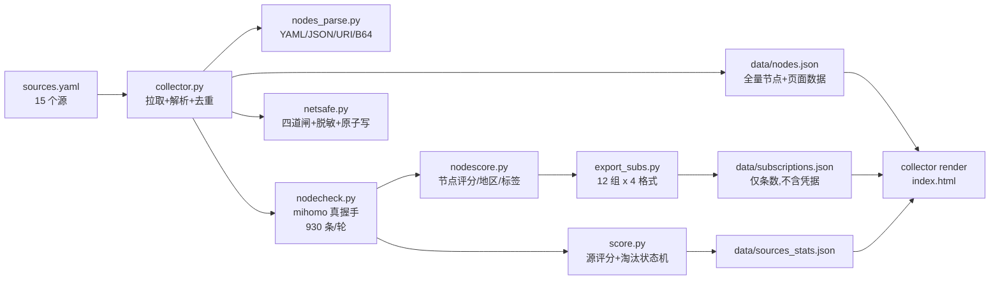
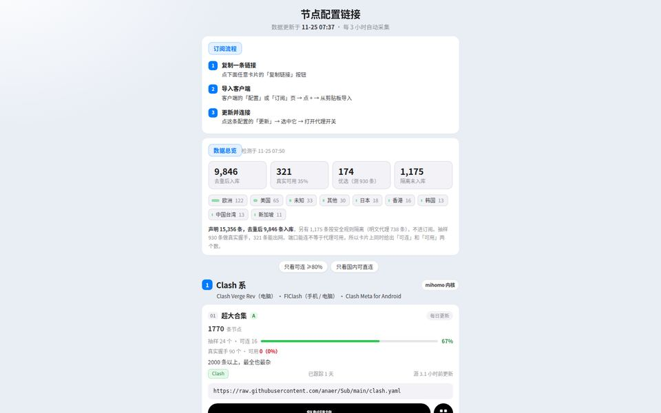
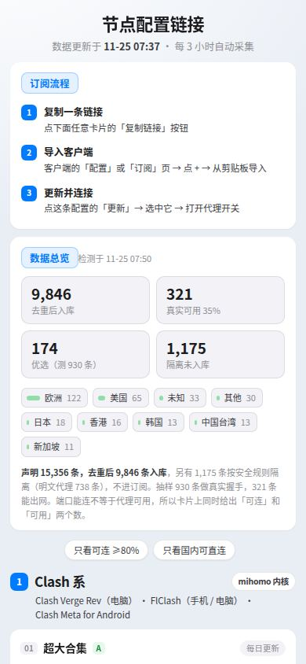

# P17 开工前审计

> 审计时间：2026-11-25 11:20（东八区）
> 对象：`BOB0098/nodes` main 分支 `6c661f5b`（P16 总结提交之后）
> 数据基线：`data/` 里 11-25 07:50 那一轮
> 方法：读代码 + 跑离线链路 + 抓 5 个宽度的真实渲染截图 + 对齐产物与页面数字。
> 结论只写能指到文件行号的东西；拿不准的标「未验证」。

---

## 1. 现状架构



| 层 | 模块 | 行数 | 职责 |
|---|---|---:|---|
| 采集 | `collector.py` | 904 | 拉源、去重、组装页面数据、渲染、写盘 |
| 解析 | `nodes_parse.py` | 713 | 四类载体 → 统一节点模型、隔离判定 |
| 检测 | `nodecheck.py` | 676 | 每节点独立 socks 端口，mihomo 真握手 |
| 节点评分 | `nodescore.py` | 275 | 六维打分、地区归类、稳定标签 |
| 源评分 | `score.py` | 554 | 源 100 分制、S/A/B/C/D、淘汰状态机 |
| 输出 | `export_subs.py` | 374 | 48 个订阅文件 + 反解校验 |
| 边界 | `netsafe.py` | 497 | 出网四闸、日志脱敏、原子写 |
| 来源治理 | `sources_io.py` / `screen.py` / `discover.py` | 145/444/250 | 登记表、四关审核、自动发现 |
| 历史 | `lifecycle.py` | 200 | 首次/最近出现、7 天新增、存活天数 |
| 运维 | `restore.py` / `drill.py` / `bench.py` / `clienttest.py` | 184/346/331/334 | 回滚、演练、压测、客户端导入 |
| 页面 | `template.html` → `index.html` | 1173 | 单文件，`const DATA = __DATA__` 注入 |

Python 约 5,700 行，页面 1,173 行，工作流 2 个（`daily.yml` 168 行、`discover.yml` 47 行）。

---

## 2. 数据流与产物

| 文件 | 大小 | 生产者 | 消费者 | 页面是否引用 | 更新时机 |
|---|---:|---|---|---|---|
| `data/nodes.json` | 1,508 KB | collector | 页面（内嵌）、export | 是 | 每轮 |
| `data/nodecheck.json` | 122 KB | nodecheck | nodescore、export | 间接 | 每轮 |
| `data/node_scores.json` | 140 KB | nodescore | export | 否 | 每轮 |
| `data/sources_stats.json` | 21 KB | score | 页面（卡片） | 是 | 每轮 |
| `data/subscriptions.json` | 4 KB | export_subs | 页面（总览） | 是 | 每轮，**晚于页面渲染** |
| `data/quarantine.json` | 13 KB | collector | 页面（总数） | 是 | 每轮 |
| `data/node_lifecycle.json` | 508 KB | lifecycle | collector（new7） | 间接 | 每轮累积 |
| `data/node_score_history.json` | 284 KB | nodescore | 页面（趋势占位） | 否 | 近 10 轮滚动 |
| `data/source_history.json` | 32 KB | score | score（波动） | 否 | 近 30 轮 |
| `data/status.json` | 2 KB | collector | 第三方监控 | 否 | 每轮 |

**去重链条（页面只讲了头尾）**：

```
声明 15,356  →  解析通过 14,181（隔离 1,175）
             →  去重后 9,846（跨源重复 4,335）
```

页面写的是「声明 15,356 条，去重后 9,846 条入库」，中间两层没交代。用户看到 5,510 条的缺口无法自洽。

---

## 3. 指标口径：三个数各说各话

| 口径 | 当前实现 | 数值（本轮） | 用在哪 |
|---|---|---|---|
| TCP 抽样可连 | 每源 24 条，绑端口试 connect | 各源 54%–100% | 源卡片进度条、源评分 40 分、**页面排序** |
| 真实握手可用 | 每源 90 条、总量 930 条，经 mihomo 访问 `generate_204` | 321/930 = **34.5%** | 数据总览、`best` 订阅 |
| 源 100 分制 | 可连率 40 + 独立新增 12 + 独立率 8 + 新鲜 12 + 稳定 18 + 合规 10 | 73.0–91.7，S1/A9/B5/C0/D0 | 卡片等级徽章、分组排序 |

三个口径同时存在不是问题，问题是**页面拿来排序的是最不可靠的那个**：

```python
# collector.py: _rank()
return ok / total * n     # TCP 可连率 × 节点数
```

而更可靠的真实握手结果 `rok` / `rtest` 在同一个函数上方已经取到（`assemble()` 第 649–650 行），**只用于显示，不参与排序**。

后果实测（Clash 分组，本轮真实卡片顺序）：

| 位置 | 源 | 节点数 | TCP 可连 | 真实握手 | 排序分 | 等级 |
|---:|---|---:|---:|---:|---:|---|
| 1 | anaer·超大合集 | 1,770 | 67% | **0/90** | 1,180 | A 87.0 |
| 2 | Barabama·多源合并 | 1,381 | 83% | 48/90 | 1,151 | A 86.2 |
| 5 | radarhub·带规则分流 | 495 | 100% | **85/90（94%）** | 495 | B 74.8 |

真实可用率 94% 的源排在第 5，0% 的排在第 1。V2Ray 分组同样：4,666 条的源真实 8/90 排第 1，3,884 条真实 **0/90** 排第 2，仍是 A 级。

---

## 4. 发现清单

### A. 会误导用户（P0，本次必须改）

| # | 发现 | 证据 | 影响 |
|---|---|---|---|
| A1 | 页面排序取「TCP 可连率 × 条数」 | `collector.py: _rank()` | 真实 94% 的源排第 5，0% 的排第 1（见 §3） |
| A2 | 源评分 40 分给 TCP，且无样本量惩罚 | `score.py:70`，`GRADES` | `anaer` 拿 A 87；5 条全重复的源拿 B 73；C/D 档空置 |
| A3 | 「可连 67%」是绿色进度条，「可用 0%」是灰色小字 | `template.html` 卡片区 | 视觉权重与可信度倒置 |
| A4 | 失败原因只有一个标签 | `nodecheck.py: probe()` 只读 `%{http_code}` | 609 条失败全是 `HTTP 000`，DNS/TCP/TLS/超时无法区分 |
| A5 | 「1,175 隔离未入库」作为指标展示 | 总览第 4 块 | 对用户决策无价值，且引发「数据怎么少了」的疑问 |

### B. 同轮数据不一致（P1）

| # | 发现 | 证据 |
|---|---|---|
| B1 | 同一轮三个「总数」：9845 / 9846 / 9846 | `nodes.json.stats.subs.all=9845`、`nodes.json.nodes=9846`、`subscriptions.json.all=9846`。订阅文件在页面渲染**之后**生成，页面读到上一轮值 |
| B2 | 去重链条只讲头尾 | 见 §2 |
| B3 | README 与实现不符 | README 第 15/38 行称「抽 24 个测 TCP 可连率」（未提 90 条真握手）；第 17 行「按可连率×节点数排」正是 A1；第 105 行「可连率占 40 分是故意的」与 P17 方向相反 |
| B4 | 无 `schema_version` | 所有 data JSON 均无版本字段，页面直接消费内嵌 JSON |

### C. 页面（P2，P21 处理）

见 §5。

### D. 工程

| # | 发现 | 证据 |
|---|---|---|
| D1 | 同一份源内容解析两次 | `collector.py:351 count_of()` 与 `:378` 各 `parse_any()` 一次 |
| D2 | 历史无限增长 | `node_lifecycle.json` 15,763 条 / 508 KB，保留 45 天逐条记录，无日级聚合 |
| D3 | 标签语义混杂 | `stats.tags` 把「隔离」「待复测」（流程态）与「机房 IP」「低延迟」（属性态）放在同一个命名空间 |
| D4 | 无页面数据校验 | 字段缺失靠 `or {}` 兜底，空数组与旧版本无区分 |

---

## 5. 页面现状（P21 的改造基线）

5 个宽度实测（360/390/768/1024/1440）：**均无横向溢出，无 console 错误**。这两项现状是好的，改造时不能退化。




对照任务书 §3.1 / §3.4 的禁令，逐条核：

| 禁令 | 现状 | 判定 |
|---|---|---|
| 大面积渐变 | `template.html:141` 径向白高光铺满整页 | ✗ |
| 每个指标配彩色卡片 | 4 个灰色数字块 + 9 个地区药丸 | ✗ |
| 过度徽章 | 序号「01」、等级「A」、协议「Clash」、状态「每日更新」、标签「已服役 1 天」 | ✗ |
| 夸张圆角 / 无目的动画 | 圆角 12px；有 `--e-spring` 弹性曲线与按压动效 | 部分 |
| 单一低饱和强调色 | 黑色主按钮 + 苹果蓝 `#007AFF` + 绿/橙/红三语义色 | ✗ |
| 首屏只留核心状态与主操作 | 首屏 1/3 是三步「订阅流程」教程；390px 下看不到任何节点 | ✗ |
| 展示无决策价值字段 | 「1,175 隔离未入库」、9 个地区抽样数、密集声明段 | ✗ |
| 移动端触控 ≥44px | 「复制链接」按钮高 44px 达标；筛选按钮 30px 不达标 | 部分 |

具体到 390px 首屏的阅读顺序：标题 → 副标 → **教程（3 步，占屏 260px）** → 4 个数字块 → 9 个药丸（3 行）→ 声明段（6 行小字）→ 2 个筛选按钮 → 源分组标题 → 第一张卡片。

用户打开页面最想做的三件事——看能不能用、找节点、复制订阅——没有一件在首屏可见。

---

## 6. 重复 / 废弃代码

| 项 | 说明 |
|---|---|
| `count_of()` 与 `collect()` 双解析 | 同上 D1，可合并为一次解析后复用结果 |
| `nodescore.py` 与 `score.py` 命名 | 一个评节点、一个评源，名字近义，新人易混；本次不改名（会断 import），在 README 与文档里写清 |
| `template.html` 里未被 DATA 引用的样式类 | 未逐个核查，P21 重写模板时自然清理 |
| `run_daily.sh` 与 `docker/run.sh` | 前者本地、后者容器，步骤重复但语义不同，保留 |

---

## 7. 风险清单

| 风险 | 触发条件 | 缓解 |
|---|---|---|
| 改排序后用户找不到原来的源 | 卡片顺序大改 | 保留分组结构、源名与 URL 不变；页面提供「按名称排序」 |
| 评分公式变更导致历史断裂 | `source_history` 里旧 grade 与新 grade 不可比 | 记录 `score_version`；历史只做趋势不做跨版本比较 |
| UI 重构破坏订阅复制 | 重写模板时交互丢失 | 先做功能回归（复制/二维码/下载），再调样式；保留 `export/` 路径与文件名 |
| 订阅文件与页面不同轮 | 渲染早于 export | P20 引入 manifest，页面只读 manifest |
| 令牌仍在流通 | 上个阶段遗留给的用户决定 | P22 提示轮换；不写入任何文件 |
| 大改后无法定位问题 | 一次提交改太多 | 每阶段独立提交 + 可回滚点（`restore.py` 管数据，git 管代码） |

---

## 8. 本次修改范围

| 阶段 | 改什么 | 不碰什么 |
|---|---|---|
| **P17** | `score.py` 权重（真实可用率 30 / TCP 10 / 样本置信 / 失败惩罚）、`nodecheck.py` 错误分类、`collector.py` 排序、`schema_version`、README 口径 | 采集链路、解析器、订阅格式 |
| **P18** | `lifecycle.py` 日级聚合与 7/30 天趋势、四类榜单、体积上限 | 指纹算法（已稳定） |
| **P19** | 来源去重识别、观察期、重复率核算 | 现有 15 个源的 id 与 url |
| **P20** | manifest 单轮一致、原子发布、旧链接兼容验证 | 12 组 × 4 格式的文件名 |
| **P21** | 重写 `template.html`：信息架构、主题、状态、无障碍、多尺寸验收 | 页面路径、`export/` 入口、URL 结构 |
| **P22** | 安全复查、数据门禁、README、全量回归 | 已稳定模块 |

**明确不做**：不换技术栈（保留 Python / mihomo / Actions / Pages）；不引入前端框架；不做流媒体/AI 检测；不重写采集链路；不删除任何现有订阅分组。

---

## 9. 验收方式

对应任务书 §8 的 14 条，逐条给命令或文件：

- 评分：`python3 score.py --selftest`（现有 7 项，本次补样本不足、置信惩罚用例）
- 错误分类：`python3 nodecheck.py --selftest`（新增分类断言）
- 一致性：新增 `python3 check_consistency.py`，比对 `nodes.json` / `subscriptions.json` / `index.html` 内嵌数据三处总数与时间戳
- 页面：Playwright 在 360/390/768/1024/1440 截图 + 断言 `scrollWidth == innerWidth` + 关键流程点击（复制、筛选、搜索）
- 订阅：`python3 export_subs.py --selftest`（含「故意传错条数必须判假」）
- 客户端：`python3 clienttest.py`（Mihomo / sing-box / Xray）
- 安全：`python3 netsafe.py`（30 项）
- 发布：`python3 drill.py`（七项故障）

---

## 10. 一句话结论

工程底子（去重、真实检测、安全边界、回滚）是够的；**问题集中在「用什么指标做决策」和「怎么把决策讲给用户听」**。
页面排序取的是最不可靠的口径，评分把 40 分给了端口而不是节点，两者叠加，让最差的源拿到了最好的位置——这就是 P17–P22 要修的东西。
